# System Validation Report — Team 5 Chat Application

**Issue:** [#80 — CHAT-TEST-003: System Validation Report](https://github.com/yashita164/SE-Mini-Project/issues/80)  
**Test date:** 11 November 2026  
**Tested revision:** `866a961` (`docs/80-system-validation-report`)  
**Environment:** Windows, Python 3.12.7, pytest 9.1.0  

## 1. Objective and scope

I ran the automated test suite and the latency and scalability scripts, then
compared their results with the SRS/STP test cases. This report also includes
screenshots of the desktop GUI and records which of issue #80's completion
criteria are still outstanding. The screenshots are in
[`system-validation-evidence/issue-80/screenshots/`](./system-validation-evidence/issue-80/screenshots/).

## 2. Execution summary

| Validation | Result | Evidence |
|---|---|---|
| Automated suite | **184 passed, 0 failed, 0 skipped** (79.70 s) | `python -m pytest -v` |
| TC-Perf-01 latency | **PASS** — 100 clients, 1,000 samples, p95 12.299 ms (limit 500 ms) | [Raw CSV](./performance/validation-run/tc-perf-01-raw.csv), [metadata](./performance/validation-run/tc-perf-01-raw.metadata.json) |
| TC-Scale-01 scalability | **PASS** — 200/200 sessions verified, 0 dropped, 5-second stability interval | [Raw CSV](./performance/validation-run/tc-scale-01-raw.csv), [metadata](./performance/validation-run/tc-scale-01-raw.metadata.json) |
| Desktop GUI checklist | Screenshots are included; manual steps were not repeated for this report | [Screenshot evidence](./system-validation-evidence/issue-80/screenshots/) |

### Commands run

My first run skipped the TLS test because OpenSSL was not on `PATH`. I added
Git for Windows' bundled OpenSSL to `PATH` and ran the full suite again. The
184-pass result below is from that second run.

```powershell
$env:PATH = 'C:\Program Files\Git\usr\bin;' + $env:PATH
.\.venv\Scripts\python.exe -m pytest -v
```

```powershell
.\.venv\Scripts\python.exe scripts\measure_message_latency.py --raw-output docs\performance\validation-run\tc-perf-01-raw.csv
.\.venv\Scripts\python.exe scripts\measure_concurrent_clients.py --raw-output docs\performance\validation-run\tc-scale-01-raw.csv
```

Both scripts completed successfully, and their metadata files record
`PASS`.

## 3. Results against the 29 SRS/STP cases

All 29 SRS/STP cases passed. The two performance cases were measured with
their standalone scripts; the remaining cases are covered by the automated
suite.

| STP case | SRS requirement | Result | Test/evidence |
|---|---|---|---|
| TC-Auth-01 | CHAT-F-001 — Registration | PASS | `test_auth.py`; registration tests in `test_server.py` |
| TC-Auth-02 | CHAT-F-002 — Authentication | PASS | `test_auth.py`; `test_server_rejects_invalid_login` |
| TC-Auth-03 | CHAT-F-003 — Logout | PASS | `test_successful_logout_closes_connection_and_removes_active_client` |
| TC-Auth-04 | CHAT-F-004 — Abrupt disconnect | PASS | `test_silent_disconnect_is_removed_from_presence_and_session` |
| TC-Msg-01 | CHAT-F-010 — Private messaging | PASS | `test_private_message_reaches_only_recipient` |
| TC-Msg-02 | CHAT-F-011 — Real-time delivery | PASS | `test_tc_msg_02_real_time_delivery_within_latency_target` |
| TC-Msg-03 | CHAT-F-012 — Offline-message queue | PASS | `test_msg_03_*` in `test_server.py` and `test_database.py` |
| TC-Msg-04 | CHAT-F-013 — Delivery acknowledgement | PASS | `tests/test_f013_delivery_ack.py` |
| TC-Msg-05 | CHAT-F-014 — Typing indicator | PASS | `test_typing_indicator_*` in `test_server.py` |
| TC-Msg-06 | CHAT-F-015 — Message history | PASS | History and reconnect tests in `test_server.py` |
| TC-Grp-01 | CHAT-F-020 — Create room | PASS | Room creation, validation and duplicate-name tests in `test_rooms.py` |
| TC-Grp-02 | CHAT-F-021 — Join/leave room | PASS | Join/leave tests in `test_rooms.py` |
| TC-Grp-03 | CHAT-F-022 — Room broadcast | PASS | Room broadcast tests in `test_rooms.py` |
| TC-Grp-04 | CHAT-F-023 — Online-user lists | PASS | Global/per-room list and disconnect tests in `test_rooms.py` |
| TC-File-01 | CHAT-F-030 — File attachment | PASS | File integrity, empty/parallel transfer and room-transfer tests |
| TC-File-02 | CHAT-F-031 — Oversized-file rejection | PASS | File-size boundary and invalid-metadata tests |
| TC-Admin-01 | CHAT-F-040 — Admin announcement | PASS | `test_tc_admin_01_*` |
| TC-Admin-02 | CHAT-F-041 — Kick/ban | PASS | `test_tc_admin_02_*` (server-wide moderation; see deviations) |
| TC-Admin-03 | CHAT-F-042 — Admin audit log | PASS | `test_tc_admin_03_*` |
| TC-Perf-01 | CHAT-NF-001 — p95 latency ≤ 500 ms | PASS | 100 clients; 1,000 samples; p95 12.299 ms |
| TC-Scale-01 | CHAT-NF-002 — 200 concurrent clients | PASS | 200 authenticated and verified sessions; 0 dropped |
| TC-Rel-01 | CHAT-NF-003 — Disconnect cleanup ≤ 30 s | PASS | `test_silent_disconnect_is_removed_from_presence_and_session` |
| TC-Ops-01 | CHAT-NF-004 — 90-day history | PASS | History boundary and pagination tests in `test_database.py` and `test_server.py` |
| TC-UX-01 | CHAT-NF-005 — Responsive client during socket I/O | PASS | `test_tc_ux_01_user_can_send_while_receiver_waits_on_slow_network` |
| TC-Sec-01 | CHAT-SR-001 — TLS | PASS | `test_tls_handshake_round_trips_application_data` (passed with OpenSSL available) |
| TC-Sec-02 | CHAT-SR-002 — Password hashing | PASS | `test_sec_02_*` in auth/server tests |
| TC-Sec-03 | CHAT-SR-003 — Input validation | PASS | `tests/test_sr003_fuzz.py` and malformed-input recovery test |
| TC-Sec-04 | CHAT-SR-004 — Session tokens | PASS | Protected-request and token-validation tests |
| TC-Sec-05 | CHAT-SR-005 — Login rate limiting | PASS | Rate-limit and successful-login reset tests |

**SRS/STP total: 29/29 passed; 0 failed; 0 blocked; 0 not run.**

## 4. Added GUI and robustness cases

The full pytest run also passed the GUI client, private-chat, file-transfer,
and room test modules. The screenshots below show the manual GUI workflows.
I did not repeat those manual steps during this test run, so the screenshots
are recorded as evidence, not as new executions on this revision.

| Case | Result | Screenshot evidence |
|---|---|---|
| TC-GUI-01 — Register/login and invalid credentials | Screenshots included; not rerun | `gui-01-login.png`, `gui-01-register.png`, `gui-01-wrong-password.png` |
| TC-GUI-02 — Dashboard | Screenshot included; not rerun | `gui-02-dashboard.png` |
| TC-GUI-03 — Private messaging and offline delivery | Screenshots included; not rerun | `gui-03-private-chat.png`, `gui-03-offline-saved.png` |
| TC-GUI-04 — History | Screenshot included; not rerun | `gui-04-history.png` |
| TC-GUI-05 — Group chat | Screenshot included; not rerun | `gui-05-room-chat.png` |
| TC-GUI-06 — File attachment and size limit | Screenshots included; not rerun | `gui-06-file-sent-room.png`, `gui-06-file-too-large.png` |
| TC-GUI-07 — Disconnect behavior | Screenshot included; not rerun | `gui-07-disconnected.png` |
| TC-GUI-08 — Terminal client independence | Screenshot included; not rerun | `gui-08-terminal-client.png` |
| TC-Grp-05 — Room typing behavior | PASS (automated) | `test_typing_indicator_is_limited_to_room_members_and_clears_on_leave` |
| TC-File-03 — Interrupted/abandoned file transfers | PASS (automated) | File-transfer cleanup, timeout and disconnect tests |

### Desktop GUI screenshot gallery

#### Startup, authentication and dashboard

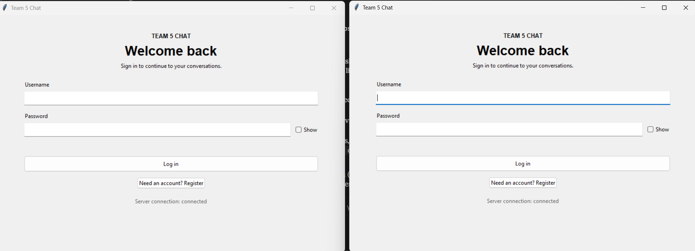

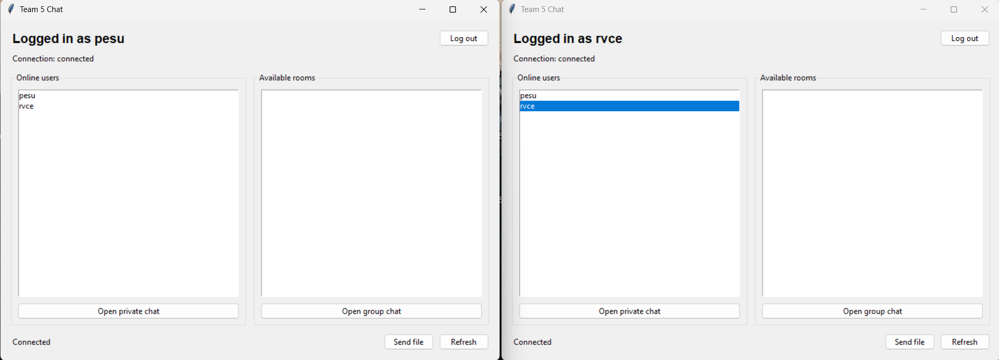

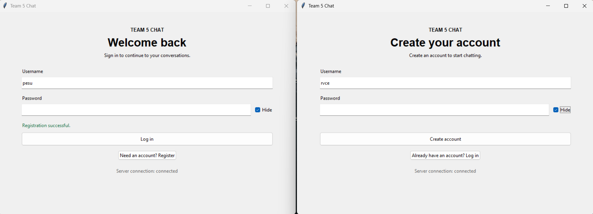

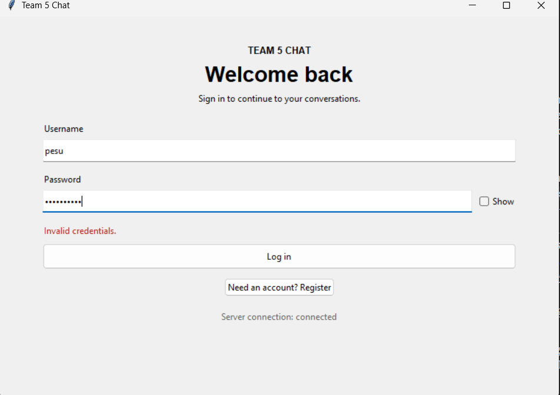

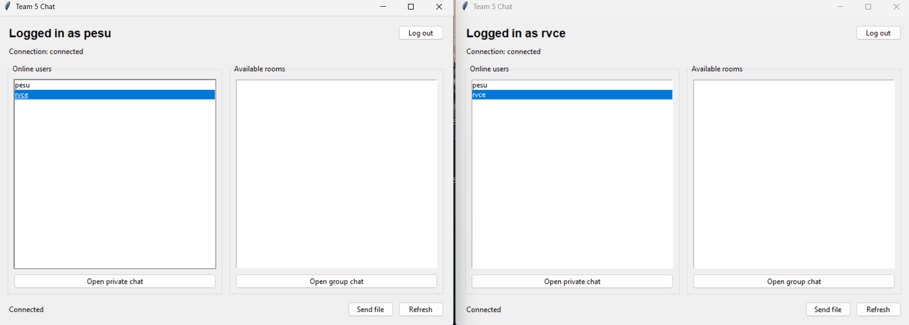

#### Private chat and history

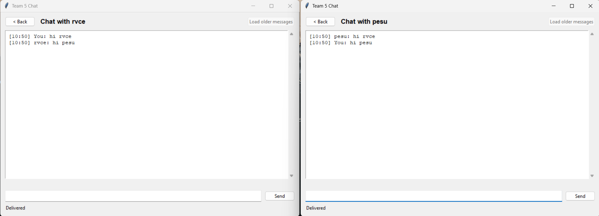

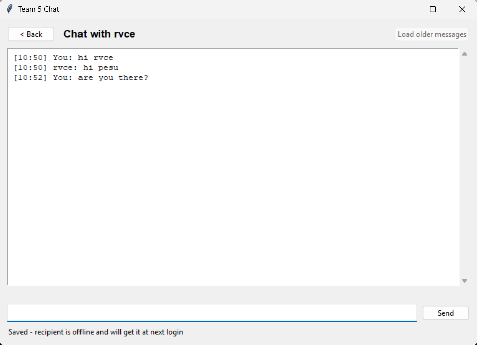

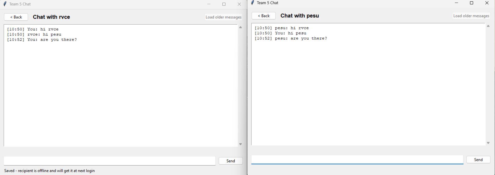

#### Group chat and files

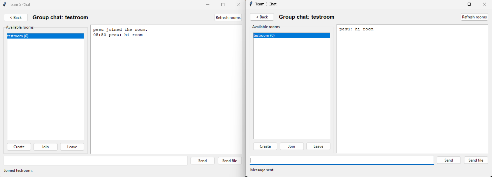

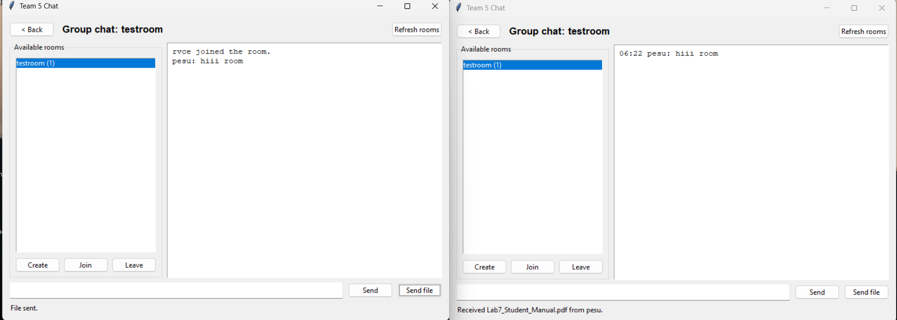

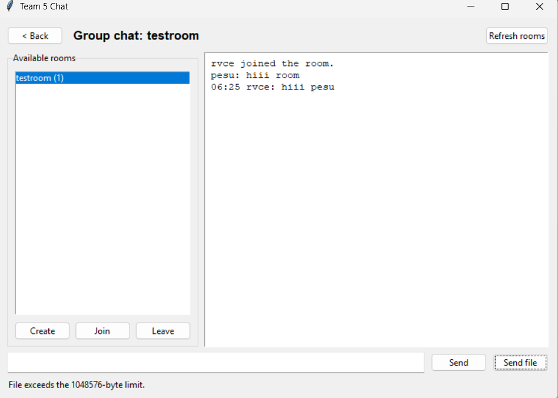

#### Disconnect and terminal client

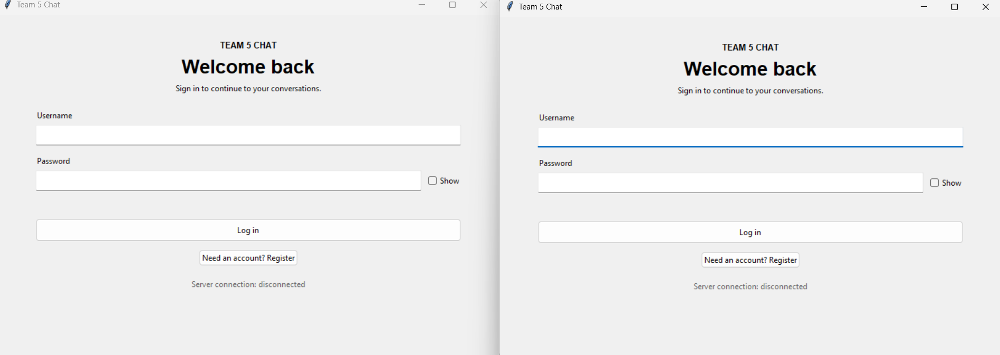

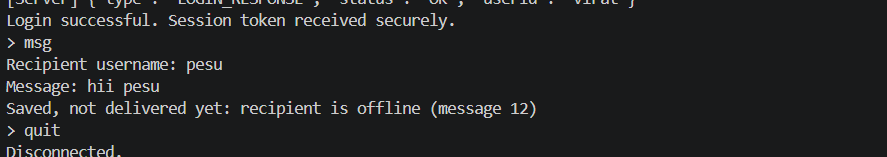

## 5. Notes

The [deviations register](./deviations.md) describes known differences from
the SRS, including server-wide rather than room-specific moderation and
in-memory room state. These are documented limitations, not test failures.
The fresh performance results and raw data are saved under
`docs/performance/validation-run/`.

## 6. Defects and exit criteria

| Issue criterion | Assessment |
|---|---|
| 100% of planned test cases executed | The 29 automated STP cases passed. Screenshots are included for the 8 GUI cases, but I did not rerun those manual steps for this report. I cannot confirm that every planned manual case was executed on this revision. |
| 0 critical defects open | I checked GitHub for open issues with the `type:bug` label and found none. |
| Report exists on `main` | Not yet. The report is on `docs/80-system-validation-report` at `866a961`; it has not been merged to `main`. |
| Feature branch and PR referencing issue #80 | Not yet. A PR still needs to be opened. |
| Independent review | Still needed. |
| CI green | Still needed for the PR. The tests reported here were run locally, not in CI. |

## 7. Conclusion

All 184 automated tests passed. The performance test recorded a p95 latency
of 12.299 ms, below the 500 ms target, and all 200 clients remained connected
during the scalability test. The screenshots provide evidence of the GUI
workflows, although I did not repeat those manual steps during this test run.
Overall, the automated and performance results met their expected criteria.